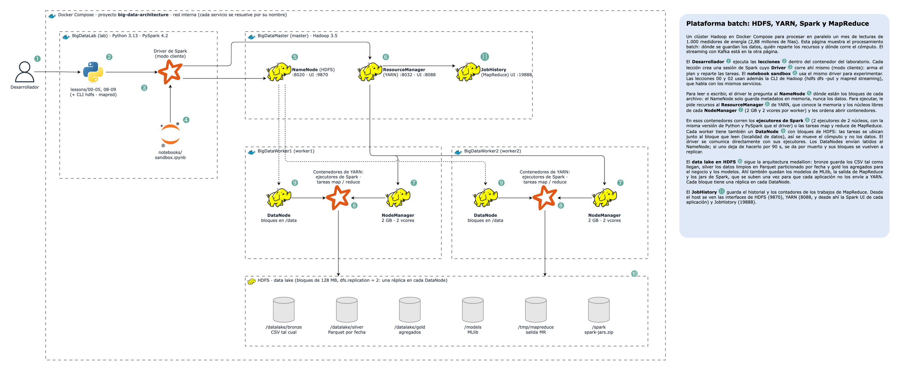

# Big Data Architecture

Proyecto para entender cómo funciona una **plataforma de big data** de punta a punta: un clúster **Hadoop** (HDFS
y YARN), **MapReduce**, **Spark** (core, SQL, rendimiento, Structured Streaming y MLlib) y **Kafka**, todo sobre un
mismo caso real: la **medición inteligente (AMI) de una distribuidora de energía**. Son 1.000 medidores que reportan
cada 15 minutos durante septiembre de 2026, con 2,88 millones de lecturas, cortes, fraudes y medidores dañados.



> Diagrama editable: [`docs/architecture.drawio`](docs/architecture.drawio).

## 1. Conceptos de big data

### ¿Qué es big data?

Se habla de big data cuando los datos ya no caben (o no se procesan a tiempo) en una sola máquina. Se suele resumir
en tres V:

| V | Qué significa | En este proyecto |
| --- | --- | --- |
| **Volumen** | Más datos de los que un servidor puede guardar o recorrer | 2,88 M lecturas al mes; una distribuidora real tiene millones de medidores |
| **Velocidad** | Datos que llegan sin parar y hay que procesar al llegar | 1.000 medidores reportan cada 15 minutos (Kafka + streaming) |
| **Variedad** | Fuentes y formatos distintos | Lecturas CSV, catálogo, clima, inspecciones de campo |

La respuesta es **escalar horizontalmente**: en lugar de un servidor más grande, muchos servidores normales que se
reparten los datos y el trabajo. Eso trae tres ideas que aparecen en todo el proyecto:

- **Particionar**: partir los datos en pedazos (bloques de HDFS, particiones de Spark, particiones de Kafka) que se
  procesan en paralelo.
- **Replicar**: guardar cada pedazo en varias máquinas para no perder nada si una se cae.
- **Llevar el cómputo a los datos**: mover un programa de pocos KB a la máquina que tiene el bloque cuesta mucho
  menos que mover el bloque por la red (*data locality*).

### Las piezas del ecosistema

| Pieza | Qué es | Qué resuelve | En este proyecto |
| --- | --- | --- | --- |
| **HDFS** | Sistema de archivos distribuido de Hadoop | Guardar archivos enormes repartidos en bloques y replicados | NameNode en `master`, DataNodes en `worker1` y `worker2` |
| **YARN** | Gestor de recursos de Hadoop | Repartir memoria y CPU del clúster entre aplicaciones | ResourceManager en `master`, NodeManagers en los workers |
| **MapReduce** | El modelo de cómputo original de Hadoop | Procesar en paralelo con dos funciones: map y reduce | Lección 02, con mappers y reducers en Python |
| **Spark** | Motor de cómputo distribuido en memoria | Lo mismo que MapReduce, pero encadenando pasos sin escribir a disco entre ellos | Corre sobre YARN; lecciones 03 a 10 |
| **Spark SQL** | SQL y DataFrames sobre Spark | Consultas declarativas que un optimizador (Catalyst) convierte en un plan eficiente | Lecciones 04 y 05 |
| **Structured Streaming** | Streams en Spark | La misma consulta de batch, aplicada a datos que no dejan de llegar | Lecciones 07 y 10 |
| **MLlib** | Machine learning distribuido de Spark | Entrenar y aplicar modelos sobre DataFrames repartidos | Lecciones 08, 09 y 10 |
| **Kafka** | Log de eventos distribuido | Recibir, guardar y repartir eventos en tiempo real entre sistemas | 3 brokers en modo KRaft |
| **Parquet** | Formato de archivo columnar | Leer solo las columnas y archivos necesarios, comprimido | Zonas silver y gold |

### El data lake y la arquitectura medallion

Los datos se guardan en HDFS por zonas, cada una más limpia que la anterior:

| Zona | Qué tiene | Formato | Ruta |
| --- | --- | --- | --- |
| **bronze** | Los archivos tal como llegaron, con sus errores | CSV | `/datalake/bronze` |
| **silver** | Datos limpios, tipados y sin duplicados | Parquet particionado por fecha | `/datalake/silver` |
| **gold** | Agregados listos para el negocio y los modelos | Parquet | `/datalake/gold` |

Nunca se borra bronze: si mañana aparece un error en la limpieza, silver y gold se vuelven a construir desde ahí.

### Batch, streaming, Lambda y Kappa

- **Batch**: procesar un conjunto de datos cerrado (el mes de septiembre). Las lecciones 02 a 05, 08 y 09 trabajan así.
- **Streaming**: procesar cada evento al llegar (las lecturas de hoy). Lecciones 06, 07 y 10.
- **Arquitectura Lambda**: dos caminos en paralelo, uno batch (exacto, lento) y uno streaming (rápido, aproximado),
  que se juntan al consultar.
- **Arquitectura Kappa**: un solo camino de streaming sobre un log que se puede releer (Kafka). Para reprocesar, se
  vuelve a leer el log desde el principio. La lección 10 sigue esta idea.

## 2. Cómo funciona cada pieza

### HDFS: bloques, réplicas y NameNode

```text
                 ¿dónde están los bloques de X?
  cliente ──────────────────────────────────────► NameNode (master)
     │      ◄──────────────── bloque 0: worker1, worker2       (solo metadatos, en memoria)
     │                        bloque 1: worker2, worker1
     │  leer / escribir bloques directamente
     ├──────────────────────► DataNode (worker1)  ◄─┐
     └──────────────────────► DataNode (worker2)  ◄─┘ réplica de bloques
```

- **Bloques**:
  - Cada archivo se parte en bloques de 128 MB (`dfs.blocksize`).
  - Un archivo de 3,7 MB ocupa un solo bloque de 3,7 MB: el bloque no se rellena.
- **Réplicas**:
  - Cada bloque se copia en `dfs.replication` DataNodes (aquí 2).
  - Si un DataNode deja de enviar latidos, el NameNode lo da por muerto (aquí a los 90 s) y ordena copiar sus bloques
    a otro nodo.
- **NameNode**:
  - Guarda en memoria el árbol de archivos y la ubicación de cada bloque, pero nunca los datos.
  - Los clientes le preguntan dónde están los bloques y luego leen o escriben directo en los DataNodes.
  - Cada archivo y cada bloque ocupa ~150 bytes de su heap. Por eso millones de archivos pequeños son un problema.
- **Escritura en tubería**: el cliente envía el bloque al primer DataNode, que lo reenvía al segundo mientras lo recibe.

### YARN: quién usa qué recursos

- El **ResourceManager** conoce la memoria y los núcleos libres de cada NodeManager (aquí 2 GB y 2 vcores cada uno).
- Cada aplicación (un trabajo MapReduce o una aplicación de Spark) recibe primero un contenedor para su
  **ApplicationMaster**, que pide más contenedores para sus tareas.
- El planificador (*Capacity Scheduler*) reparte el clúster en colas. Aquí hay una sola: `default`.

### MapReduce

```text
 bloques ──► map (por bloque) ──► combiner ──► shuffle (ordenar y agrupar por clave) ──► reduce ──► part-0000N
             (día, kWh, 1, inválida)  suma local      viaja por la red                   suma total
```

Cada fase escribe a disco y la siguiente lo vuelve a leer. Es robusto, pero lento cuando un cálculo necesita muchos
pasos. Esa es la razón de ser de Spark.

### Spark

| Concepto | Qué es |
| --- | --- |
| **Driver** | El programa que arma el plan y reparte tareas. Aquí corre en el contenedor `lab` (modo cliente). |
| **Ejecutor** | Una JVM en un contenedor de YARN que ejecuta tareas y guarda datos en caché. Aquí, 2 ejecutores de 2 núcleos. |
| **Partición** | Un pedazo de los datos. Una tarea procesa una partición. |
| **Transformación** | Describe un paso (`filter`, `groupBy`, `join`). Es perezosa: no ejecuta nada. |
| **Acción** | Pide un resultado (`count`, `collect`, `write`) y dispara el trabajo. |
| **Shuffle** | Redistribuir datos entre ejecutores para juntar las filas de cada clave. Es lo más caro. |
| **Stage** | Tramo de un trabajo sin shuffle. Cada shuffle abre un stage nuevo. |
| **Catalyst / AQE** | El optimizador de consultas y su versión adaptativa, que reajusta el plan con el tamaño real de los datos. |

### Kafka

```text
 productor ──(clave = meter_id)──► meter-readings
                                   ├─ partición 0  [0][1][2][3]...   líder kafka2, réplicas kafka3, kafka1
                                   ├─ partición 1  [0][1][2]...      líder kafka3, réplicas kafka1, kafka2
                                   └─ ...
 grupo "dashboard": consumidor 1 ← particiones 3, 4, 5 · consumidor 2 ← particiones 0, 1, 2
 grupo "billing":   lee lo mismo de forma independiente, con sus propios offsets
```

- **Tema y partición**:
  - Un tema es un log dividido en particiones.
  - La clave decide la partición, así que las lecturas de un medidor siempre caen en la misma y llegan en orden.
- **Réplicas e ISR**:
  - Cada partición tiene un líder y seguidores.
  - Con `acks=all` y `min.insync.replicas=2`, un mensaje confirmado está en al menos dos brokers.
- **Offsets y grupos de consumidores**:
  - Cada grupo guarda hasta dónde leyó.
  - Leer no borra nada: los mensajes viven hasta que vence la retención (aquí 7 días).
- **KRaft**: los brokers eligen entre ellos un controlador que lleva los metadatos. Ya no hace falta ZooKeeper.

### Structured Streaming

- Un stream es una tabla que crece. La consulta se escribe igual que en batch y se ejecuta en **micro-lotes**.
- **Tiempo del evento y watermark**:
  - Las ventanas se calculan con la hora de la lectura, no con la de llegada.
  - El watermark (hora máxima vista menos un margen) decide cuándo cerrar una ventana y descartar lo que llegue
    después.
- **Checkpoint**: guarda en HDFS los offsets de Kafka y el estado de las agregaciones. Junto con un sink idempotente
  (archivos), da **exactamente una vez**.

### MLlib

- **Pipeline**: cadena de transformadores (`StringIndexer`, `VectorAssembler`, `SQLTransformer`) y estimadores
  (`GBTRegressor`, `RandomForestClassifier`, `KMeans`).
- `fit()` entrena en el clúster; el `PipelineModel` resultante se guarda en HDFS y se aplica igual a un DataFrame
  batch o a un stream.
- **Validación**: `TrainValidationSplit` y `CrossValidator` comparan hiperparámetros en paralelo.

## 3. Cómo está armado el proyecto

| Contenedor | Imagen / procesos | Puertos en el host | Rol |
| --- | --- | --- | --- |
| `BigDataMaster` (`master`) | Hadoop 3.5 · NameNode, ResourceManager, JobHistory | 9870, 8088, 19888 | Maestro de HDFS y YARN |
| `BigDataWorker1` (`worker1`) | Hadoop 3.5 · DataNode, NodeManager | - | Guarda bloques y ejecuta contenedores |
| `BigDataWorker2` (`worker2`) | Hadoop 3.5 · DataNode, NodeManager | - | Guarda bloques y ejecuta contenedores |
| `BigDataKafka1-3` (`kafka1-3`) | `apache/kafka:4.3.1` · broker + controlador KRaft | 19092-19094 | Cluster de Kafka |
| `BigDataLab` (`lab`) | Python 3.13 · PySpark 4.2 · confluent-kafka · CLI de Hadoop · JupyterLab | 4040, 8890 | Driver de Spark, lecciones y sandbox |

**Una sola imagen para Hadoop y el laboratorio**:

- Los nodos de Hadoop y el laboratorio usan la misma imagen: Python 3.13, Java 17 (Temurin), Hadoop 3.5, PySpark 4.2
  y el conector de Kafka para Spark.
- Así, los ejecutores de Spark que YARN lanza en los workers tienen la misma versión de Python y de PySpark que el
  driver, algo que PySpark exige.
- La imagen oficial de Hadoop solo existe para x86. De ella solo se copia `/opt/hadoop`, que es Java y corre en ARM
  (Apple Silicon).

**Arranque**:

1. `master` formatea el NameNode la primera vez (`hadoop/master.sh`) y arranca NameNode, ResourceManager y JobHistory.
2. `worker1` y `worker2` arrancan DataNode y NodeManager, y se registran en el maestro.
3. Los tres brokers de Kafka forman el quórum KRaft y eligen un controlador.
4. `entrypoint.sh` (en `lab`) espera a HDFS (fuera de modo seguro, 2 DataNodes), YARN (2 NodeManagers) y Kafka
   (3 brokers). Además, sube una vez los jars de Spark a HDFS (`spark.yarn.archive`) para que cada aplicación no
   envíe ~400 MB a YARN.

```text
.docker/
  Dockerfile                    # img-base (Python + Java + Hadoop + PySpark) -> img-lab
  docker-compose.yml            # Contenedor BigDataLab
  hadoop.yml                    # master, worker1, worker2
  kafka.yml                     # kafka1, kafka2, kafka3 (KRaft)
  hadoop/master.sh, worker.sh   # Qué demonios corre cada nodo
  hadoop/conf/                  # core-site, hdfs-site, yarn-site, mapred-site, capacity-scheduler
  spark/spark-defaults.conf     # Spark en YARN: ejecutores, memoria, zona horaria
  entrypoint.sh                 # Instala requirements, espera el clúster y sube los jars de Spark
.envs/lab.env                   # Direcciones de HDFS, YARN y Kafka para el laboratorio
.envs/kafka.env                 # Configuración común de los brokers
docs/architecture.drawio        # Diagrama
src/lab/                        # Generador de datos, simulador, helpers de HDFS, Spark y Kafka
lessons/                        # Lecciones 00-10 (y el mapper/reducer de la 02)
notebooks/sandbox.ipynb         # Sandbox para experimentar con todo lo anterior
```

### El conjunto de datos

`src/lab/dataset.py` genera siempre los mismos datos (semilla fija):

| Archivo | Qué tiene |
| --- | --- |
| `meters.csv` | 1.000 medidores: 81 % residenciales (con estrato 1-6), 14 % comerciales, 5 % industriales, en 6 ciudades y 24 circuitos |
| `readings_2026-09-DD.csv` | Una lectura cada 15 minutos por medidor: `meter_id, ts, kwh, voltage` (30 archivos, 107 MB) |
| `weather.csv` | Temperatura horaria por ciudad (de 14 °C en Bogotá a 28 °C en la costa) |
| `inspections.csv` | 300 visitas de campo en octubre: `fraude`, `medidor dañado` o `normal` |

El consumo depende del tipo de cliente, la hora, el día de la semana y la temperatura (aire acondicionado sobre 24 °C).
Los datos traen incidentes para que haya algo que encontrar:

| Incidente | Dónde | Lo detecta |
| --- | --- | --- |
| Lecturas faltantes (0,5 %), duplicadas (0,3 %), kWh negativos y voltaje vacío | Todos los archivos | Lección 04 |
| Corte de servicio de 3 horas | Circuito `BAQ-03`, 17 de septiembre | Lección 04 |
| Subtensión todas las noches (92 % del nominal) | Circuito `CLO-02`, 18:00 a 22:00 | Lección 04 |
| Fraude: el medidor registra solo el 30-60 % desde un día del mes | 40 medidores | Lecciones 04 y 09 |
| Medidor dañado que repite la misma lectura | 5 medidores | Lección 09 |

## 4. Puesta en marcha

Asigna **al menos 10 GB de memoria a Docker** (Docker Desktop → Settings → Resources → Memory). El clúster usa
unos 5 GB en reposo y VS Code dentro del contenedor otro 1,5 GB. Cuando Spark lanza su driver y sus ejecutores, con
8 GB o menos la máquina virtual de Docker se queda sin memoria y el kernel mata procesos Java (OOM): una lección falla
con `Py4JNetworkError` o `Connection refused`. El `entrypoint.sh` avisa si Docker tiene menos de 9 GB. Si tienes
corriendo los laboratorios de MongoDB o PostgreSQL, detenlos antes.

**Con VS Code**: `Dev Containers: Reopen in Container`.

**Con la terminal**:

```bash
cd .docker
docker compose -f docker-compose.yml -f hadoop.yml -f kafka.yml up -d --build
docker exec BigDataLab .docker/entrypoint.sh          # cada vez que se crea el contenedor
docker exec -it BigDataLab bash                       # entrar al contenedor
```

La primera construcción descarga Hadoop, Java y PySpark (unos minutos). Dentro del contenedor (`/app`):

```bash
python lessons/00_seed.py      # siempre primero
python lessons/01_hdfs.py      # y así con las demás, en orden
hdfs dfs -ls -R /datalake      # la CLI de Hadoop funciona directo
yarn application -list -appStates ALL
```

Apagar (`stop`) o borrar todo, incluidos HDFS y Kafka (`down -v`):

```bash
cd .docker
docker compose -f docker-compose.yml -f hadoop.yml -f kafka.yml down -v
```

### Interfaces web

| Interfaz | URL | Qué mirar |
| --- | --- | --- |
| HDFS (NameNode) | http://localhost:9870 | *Datanodes*, *Utilities → Browse the file system* (bloques y réplicas de cada archivo) |
| YARN (ResourceManager) | http://localhost:8088 | Aplicaciones, contenedores y memoria por nodo |
| Spark UI | `http://localhost:8088/proxy/<applicationId>/` | Jobs, stages, DAG, SQL, *Structured Streaming*. Cada lección imprime su URL |
| JobHistory (MapReduce) | http://localhost:19888 | Contadores y tareas de los trabajos de la lección 02 |
| Kafka | `localhost:19092,localhost:19093,localhost:19094` | Para un cliente como Offset Explorer o `kcat` desde el host |

Los enlaces internos de las interfaces apuntan a `master`, `worker1` o `worker2`, que el host no conoce. Para
seguirlos, cambia el nombre por `localhost` (solo funciona con los puertos publicados) o agrega esos nombres a
`/etc/hosts`.

## 5. Lecciones

| Lección | Qué hace | Qué observar |
| --- | --- | --- |
| `00_seed.py` | Genera los 30 días de lecturas y el catálogo, y los sube a la zona bronze con `hdfs dfs -put`. | 107 MB en HDFS ocupan 214 MB en disco: cada bloque está en los dos DataNodes. |
| `01_hdfs.py` | Estado del clúster por JMX, `fsck` de un archivo, el mismo archivo con bloques de 1 MB, `setrep`, el problema de los archivos pequeños, snapshots y una lectura por WebHDFS. | Cada bloque tiene una réplica en worker1 y otra en worker2. WebHDFS responde `307` y redirige al DataNode: los datos no pasan por el NameNode. |
| `02_mapreduce.py` | MapReduce en miniatura (`mapper \| sort \| reducer`) y dos trabajos de Hadoop Streaming en YARN: uno con un map por archivo y otro con `CombineTextInputFormat` y combiner. | De 30 maps a 2 y de 65 MB de shuffle a 1 KB. `data_local_maps`: maps que corrieron junto a su bloque. |
| `03_spark_core.py` | Ejecutores en YARN, RDD, evaluación perezosa, linaje, stages, localidad de datos, particiones, broadcast, acumuladores, `cache()` y el mismo cálculo con DataFrames. | Las 30 tareas que leen HDFS son `NODE_LOCAL`. El plan de DataFrames lee 3 de 4 columnas y suma antes del shuffle. |
| `04_spark_sql.py` | Bronze → silver → gold: esquema explícito, calidad de datos, limpieza, Parquet particionado por fecha, SQL, funciones de ventana, joins y eventos de la red. | 107 MB de CSV quedan en 12 MB de Parquet. Aparecen el corte de `BAQ-03` y la subtensión de `CLO-02`. |
| `05_spark_performance.py` | Mide bytes leídos, shuffle y tiempo de: CSV contra Parquet, poda de particiones y columnas, `shuffle.partitions`, AQE, broadcast contra sort-merge, skew con salting, `cache()` y número de archivos al escribir. | Un día en Parquet lee 0,2 MB contra 107 MB en CSV. El join broadcast no hace shuffle; el sort-merge mueve 26 MB. |
| `06_kafka.py` | Crea los temas, produce un día (96.000 mensajes) con `acks=all` e idempotencia, consume con dos grupos, mide el lag y hace replay desde una hora con `offsets_for_times`. | Las particiones y sus líderes se reparten entre los 3 brokers. Dos consumidores se reparten las 6 particiones. |
| `07_spark_streaming.py` | Kafka → ventanas de 1 hora por circuito con watermark → HDFS. El simulador manda la mitad de `BOG-01` con 2 horas de retraso. Detiene las consultas y reanuda desde el checkpoint. | `BOG-01` queda con la mitad de sus lecturas: llegaron tarde. Tras reanudar: enviadas = archivadas, 0 duplicados. |
| `08_mllib_regression.py` | Pipeline (`StringIndexer`, `VectorAssembler`, `GBTRegressor`, `SQLTransformer`) que predice el consumo horario de cada medidor. Split por fecha, `TrainValidationSplit` y comparación con "la misma hora hace 7 días". | El modelo le gana al baseline en los tres tipos de cliente (WAPE de 7 % contra 9 %). Se guarda en `/models/hourly_kwh`. |
| `09_mllib_fraud.py` | KMeans sobre la curva de carga de cada medidor y un Random Forest con las inspecciones como etiquetas, con validación cruzada y pesos por clase. Genera la lista de inspección. | KMeans separa hogares, comercios e industrias sin etiquetas. Los 10 fraudes sin inspeccionar quedan en el top 15. |
| `10_streaming_ml.py` | Kafka → consumo por medidor y hora → join con el catálogo y el clima → modelo de la lección 08 → reglas → alertas en el tema `meter-alerts`, leídas por otro consumidor. | En vivo: el corte de `MED-02`, un consumo 5 veces mayor y un medidor que deja de registrar. |

Las lecciones 07 y 10 usan el tema creado en la 06; la 10 usa el modelo de la 08. Para empezar de cero:
`python lessons/00_seed.py` y luego el resto en orden.

### Sandbox

[`notebooks/sandbox.ipynb`](notebooks/sandbox.ipynb) reúne todo en un solo lugar para experimentar:

- las zonas del data lake como vistas de SQL, con funciones listas (`sql`, `hdfs`, `plan`, `bloques`, `particiones`,
  `topico`);
- archivos con otro tamaño de bloque y otra replicación, y dónde queda cada bloque;
- curvas de carga, consumo contra temperatura y un circuito en un día (con gráficos);
- planes de ejecución con y sin broadcast y con más o menos particiones de shuffle;
- un tema de Kafka propio (`sandbox-events`) para producir y consumir;
- una consulta de streaming en vivo sobre el simulador, consultable con SQL mientras corre;
- el modelo de la lección 08: real contra predicho y "¿qué pasa si hace 4 °C más?";
- tus propios datos en `/sandbox`.

Las celdas marcadas **Juega aquí** están hechas para cambiarlas. Necesita las lecciones 00, 04 y 08. Hay dos formas
de abrirlo:

- **VS Code (Dev Container)**: abre el archivo y elige el kernel de Python 3.13 del contenedor.
- **Navegador (JupyterLab)**: el contenedor publica el puerto 8890 (8888 y 8889 los usan los laboratorios de
  MongoDB y PostgreSQL).

  ```bash
  docker exec -it BigDataLab jupyter lab --ip 0.0.0.0 --port 8890 --no-browser --notebook-dir /app
  ```

  Abre en tu equipo la URL `http://127.0.0.1:8890/lab?token=…` que imprime el comando, y `Ctrl+C` para cerrarlo.

## 6. Experimentos

Desde el host:

```bash
# Un DataNode se cae: a los 90 s el NameNode lo da por muerto y sus bloques quedan con una sola réplica
docker stop BigDataWorker2
docker exec BigDataLab hdfs dfsadmin -report | grep -E "Live|Dead"
docker exec BigDataLab hdfs fsck / | grep -iE "under.replicated|status"
docker exec BigDataLab hdfs dfs -cat /datalake/bronze/meters/meters.csv | head -3   # se sigue leyendo
docker start BigDataWorker2                                                         # vuelve y se re-replica

# Un broker de Kafka se cae: sus particiones eligen otro líder y el ISR se reduce a 2
docker stop BigDataKafka1
docker exec BigDataKafka2 /opt/kafka/bin/kafka-topics.sh --bootstrap-server kafka2:9092 --describe --topic meter-readings
docker start BigDataKafka1

# Con dos brokers caídos, el ISR queda en 1 < min.insync.replicas = 2: los productores con acks=all fallan
docker stop BigDataKafka1 BigDataKafka2
docker start BigDataKafka1 BigDataKafka2

# Un worker se cae durante un trabajo de Spark: YARN pierde el ejecutor y Spark rehace sus tareas en el otro nodo
docker exec BigDataLab python lessons/05_spark_performance.py &
sleep 25 && docker stop BigDataWorker1 && sleep 30 && docker start BigDataWorker1
```

Comandos útiles dentro de `BigDataLab`:

```bash
hdfs dfs -ls -R /datalake | head                  # el data lake
hdfs fsck /datalake/silver -files -blocks         # bloques de cada archivo Parquet
hdfs dfsadmin -report                             # capacidad y estado de cada DataNode
yarn node -list -all                              # NodeManagers y sus contenedores
yarn application -list -appStates ALL             # aplicaciones de Spark y MapReduce
yarn logs -applicationId <id> | less              # logs de todos los contenedores de una aplicación
mapred job -list all                              # trabajos de MapReduce
pyspark                                           # shell interactivo de Spark en YARN
SPARK_MASTER='local[*]' python lessons/04_spark_sql.py   # la misma lección sin YARN, solo en este contenedor
```

## Notas

- **Seguridad de laboratorio**: HDFS y YARN no tienen autenticación (Kerberos) y Kafka usa `PLAINTEXT`, sin TLS ni
  SASL. En producción se usan Kerberos, TLS, ACLs y redes privadas.
- **Recursos**:
  - Cada demonio de Hadoop limita su heap a 256 MB y cada broker de Kafka a 256 MB.
  - YARN ofrece 2 GB y 2 vcores por worker.
  - Spark pide 2 ejecutores de 512 MB + 256 MB de overhead y un driver de 768 MB (`.docker/spark/spark-defaults.conf`).
- **Escala**:
  - Los datos son pequeños para que todo corra en un portátil. Las ideas son las mismas con 1 TB.
  - Para probar con más datos, sube `METERS` o `DAYS` en `src/lab/dataset.py` y vuelve a ejecutar la lección 00.
- **Un solo NameNode** es un punto único de falla. En producción se usa HDFS HA (dos NameNodes con JournalNodes y
  ZooKeeper) o un almacenamiento de objetos (S3, ADLS, GCS) en lugar de HDFS.
- **Más allá de este proyecto**: Hive Metastore o Unity Catalog para un catálogo de tablas persistente; formatos de
  tabla (Delta Lake, Apache Iceberg) para transacciones ACID sobre el data lake; Airflow para orquestar las lecciones
  como un pipeline diario; Flink como alternativa de streaming.
